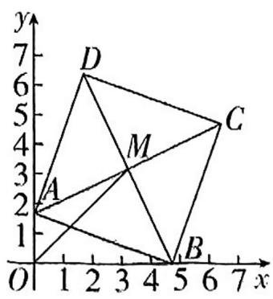
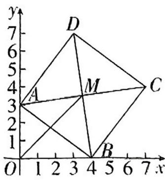
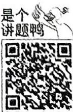

<!-- question-source:start -->
6 核心素养模型观念 [2024 福建福州质检, 较难] 如图(1), 在平面直角坐标系中, 放置一个边长为 5 的正方形 $ABCD$ , 使得它的两个顶点 $B$ 和 $A$ 恰好落在 $x$ 轴正半轴和 $y$ 轴正半轴上, $M$ 为正方形的中心, 连接 $OM$ .

(1) 若点 $B$ 和点 $A$ 分别在 $x$ 轴和 $y$ 轴的正半轴上滑动, 求证: 在这个运动过程中, $M$ 始终在第一象限的角平分线上.

(2)如图(2),若点 $A$ 运动到 $(0,3)$ ,求此时 $M$ 点的坐标.

图(1)

图(2)

电子错题本鸭
<!-- question-source:end -->

![[Q00107354A1]]
