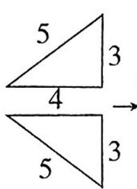
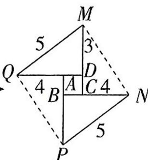

<!-- question-source:start -->
1 新考法 [2024 河北唐山调研, 中] 将图(1)中两个三角形按图(2)所示的方式摆放, 其中四边形 ABCD 为矩形, 连接 PQ, MN, 甲、乙两人有如下结论:

甲·若四边形 ABCD 是边长为 1 的正方形, 则四边形 PQMN 必是正方形;
乙 若四边形 PQMN

图(1)

图(2)

为正方形,则四边形 ABCD 必是边长为 1 的正方形. 下列判断正确的是 ( )
A. 甲正确,乙不正确
B. 甲不正确,乙正确
C. 甲、乙都不正确
D. 甲、乙都正确
<!-- question-source:end -->

![[Q00107765A1]]
