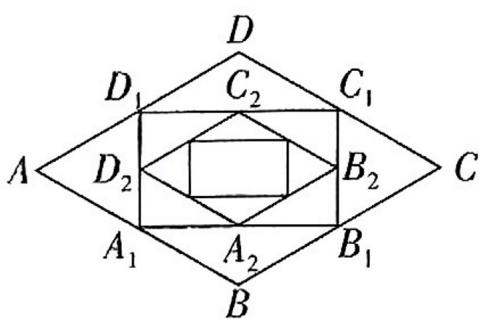
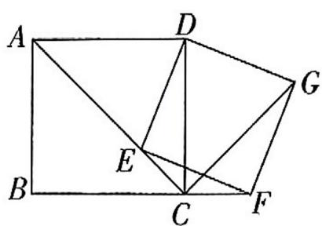

<!-- question-source:start -->
2 [2025 广东广州期中, 中]如图, 已知菱形 ABCD 的边长为 $2, \angle BAD = 60^{\circ}$ , 进行如下操作: 第一次, 顺次连接菱形 ABCD 各边的中点, 得到四边形 $A_{1}B_{1}C_{1}D_{1}$ ; 第二次, 顺次连接四边形 $A_{1}B_{1}C_{1}D_{1}$ 各边的中点, 得到四边形 $A_{2}B_{2}C_{2}D_{2}$ ; …, 如此反复操作下去, 则第 n 次操作后, 得到四边形 $A_{n}B_{n}C_{n}D_{n}$ 的面积是 ( )

A. $\frac{\sqrt{3}}{2^{n}}$ B. $\frac{\sqrt{3}}{2^{n-1}}$ C. $\frac{\sqrt{3}}{2^{n+1}}$ D. $\frac{\sqrt{3}}{2^{2n}}$

(第2题图)

(第3题图)
<!-- question-source:end -->

![[Q00107766A1]]
