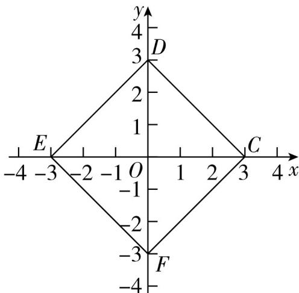
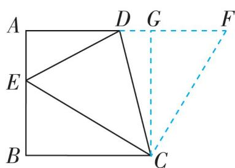
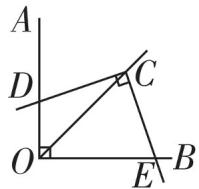
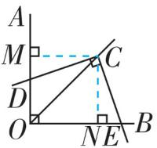
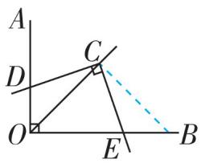
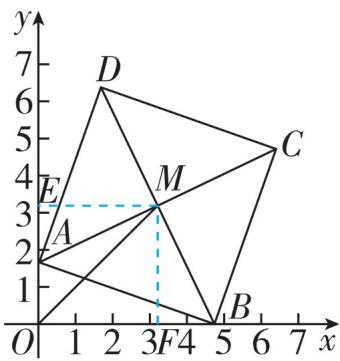
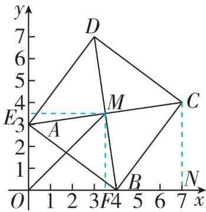

> [!success]- 必刷题
>
> > [!success] **【答案】** 18
>
> > [!note]- **【解析】**
> > 设点 P 的坐标为 $(x, y)$ . ∵ P 是 AB 中点, A 在 x 轴上, B 在 y 轴上, ∴ A $(2x, 0)$ , B $(0, 2y)$ , ∴ OA = |2x| = 2|x|, OB = |2y| = 2|y|. ∵ OA + OB = 6, ∴ |x| + |y| = 3. 如图, 当 $x \geqslant 0, y \geqslant 0$ 时, 点 P 运动的轨迹是线段 CD, 其中 OC = OD = 3; 当 $x \geqslant 0, y \leqslant 0$ 时, 点 P 运动的轨迹是线段 CF, 其中 OC = OF = 3; 当 $x \leqslant 0, y \geqslant 0$ 时, 点 P 运动的轨迹是线段 DE, 其中 OE = OD = 3; 当 $x \leqslant 0, y \leqslant 0$ 时, 点 P 运动的轨初中必刷题 数学九年级上册 BS
> >
> > 迹是线段 $EF$ ，其中 $OE = OF = 3$ . $\because EC \perp DF, OC = OD = OE = OF,$ $\therefore$ 四边形 $CDEF$ 是正方形， $\therefore$ 所有满足条件的点 $P$ 围成的封闭图
> >
> > 
> >
> > 形是正方形,∴ 这个封闭图形的面积为 $\frac{1}{2} \times 6 \times 6 = 18$ . 故答案为 18.
> >
> > 添加辅助线
> > 过 C 作 $CG \perp AD$ ，交 AD 延长线于 G，延长 DG 至 F，使 GF = BE，连接 CF，先证四边形 ABCG 是正方形，再证 $\triangle ECD \cong \triangle FCD$ ，得 DE = DF。设 DE = x，在 Rt $\triangle AED$ 中利用勾股定理可求出 ED 的长。
> >
> > 【解析】如图, 过 C 作 $CG \perp AD$ , 交 AD 的延长线于 G, 并延长 DG 至 F, 使 GF = BE, 连接 CF. $\because \angle A = \angle B =$
> >
> > 
> >
> > $\angle CGA = 90^{\circ}, AB = BC, \therefore$ 四边形 $ABCG$ 为正方形, $\therefore AG = BC = 4, \angle BCG = 90^{\circ}, BC = CG.$ $\because AD = 3, \therefore DG = 4 - 3 = 1. \because BC = CG, \angle B = \angle CGF, BE = FG, \therefore \triangle EBC \cong \triangle FGC(SAS), \therefore CE = CF, \angle ECB = \angle FCG. \because \angle DCE = 45^{\circ}, \therefore \angle BCE + \angle DCG = \angle DCG + \angle FCG = 45^{\circ}, \therefore \angle DCE = \angle DCF. \because CE = CF, \angle DCE = \angle DCF, DC = DC, \therefore \triangle ECD \cong \triangle FCD(SAS), \therefore ED = DF.$ 设 $ED = x$ , 则 $EB = FG = x - 1$ , $\therefore AE = 4 - (x - 1) = 5 - x. \because Rt\triangle AED$ 中, $AE^{2} + AD^{2} = DE^{2}, \therefore (5 - x)^{2} + 3^{2} = x^{2}$ , 解得 $x = 3.4$ , $\therefore DE = 3.4$ . 故答案为 3.4.
> >
> > 思路分析
> > (2) 点 A 运动到 $(0,3)$ ，由勾股定理得出 OB 的长，作 $ME \perp y$ 轴于 E 点，作 $MF \perp x$ 轴于 F 点，作 $CN \perp x$ 轴于 N 点，则四边形 AONC 是直角梯形，四边形 EMFO 是正方形， $\angle AOB = \angle CNB = 90^{\circ}$ ，由正方形性质得出 MA = MC, AB = BC, $\angle ABC = 90^{\circ}$ ，推出 MF 是直角梯形 AONC 的中位线， $\angle ABO + \angle CBN = 90^{\circ}$ ，证得 $\angle BAO = \angle CBN$ ，由 AAS 证得 $\triangle BAO \cong \triangle CBN$ ，得出 CN = OB, BN = OA，进而得出 $MF = \frac{1}{2}(OA + CN)$ ， $OF = \frac{1}{2}(OB + BN)$ ，即可得出结果.
> >
> > ## 6. 模型归纳 | 含 $90^{\circ}$ 角的对角互补模型
> >
> > <table><tr><td>基本模型</td><td>作垂线法</td><td>旋转法</td></tr><tr><td></td><td></td><td></td></tr><tr><td>已知:OC平分∠AOB</td><td colspan="2">结论:1CD=CE,2OD+OE=√2OC,3S△OCD+S△OCE=1/2OC2</td></tr></table>
> >
> > (1)【证明】作 $ME \perp y$ 轴于 E 点, 作 $MF \perp x$ 轴于 F 点, 如图(1)所示, 则四边形 EMFO 是矩形, $\angle EMF = \angle MEA = \angle MFB = 90^{\circ}, \therefore \angle EMA + \angle AMF = 90^{\circ}$ . ∵ 四边形 ABCD 是正方形, ∴ MA = MB, $\angle AMF + \angle FMB = 90^{\circ}, \therefore \angle EMA = \angle FMB$ . 在 $\triangle MEA$ 和 $\triangle MFB$ 中, $\left\{\begin{aligned}\angle MEA &= \angle MFB, \\ \angle EMA &= \angle FMB, \therefore \triangle MEA &\cong \triangle MFB(AAS), \\ MA &= MB,\end{aligned}\right.$ ∴ ME = MF, ∴ 四边形 EMFO 是正方形, ∴ 点 M 在 $\angle AOB$ 的平分线上, ∴ M 始终在第一象限的角平分线上.
> >
> > 
> >
> > 
> > 图(1)
> > 图(2)
> >
> > (2)【解】∵点A运动到(0,3)，∴OA=3.
> > ∵AB=5，∴OB= $\sqrt{AB^{2}-OA^{2}}=\sqrt{5^{2}-3^{2}}=4$ . 作ME⊥y轴于E点，作MF⊥x轴于F点，作CN⊥x轴于N点，如图(2)所示，则MF//OA//CN，四边形AONC是直角梯形，四边形EMFO是正方形， $\angle AOB=\angle CNB=90^{\circ}$ ．∵四边形ABCD是正方形，∴MA=MC，AB=BC， $\angle ABC=90^{\circ}$ ，∴MF是直角梯形AONC的中位线， $\angle ABO+\angle CBN=90^{\circ}$ ．∵ $\angle BAO+\angle ABO=90^{\circ}$ ，∴ $\angle BAO=\angle CBN$ . 在 $\triangle BAO$ 和 $\triangle CBN$ 中， $\left\{\begin{aligned}\angle AOB&=\angle CNB,\\ \angle BAO&=\angle CBN,\\ AB&=BC,\end{aligned}\right.$ ∴ CN = OB = 4, BN = OA = 3, ∴ MF = $\frac{1}{2}$ (OA + CN) = $\frac{1}{2}$ (3 + 4) = $\frac{7}{2}$ , OF = $\frac{1}{2}$ (OB + BN) = $\frac{1}{2}$ (4 + 3) = $\frac{7}{2}$ , ∴ M 点的坐标为 $\left(\frac{7}{2},\frac{7}{2}\right)$ .
