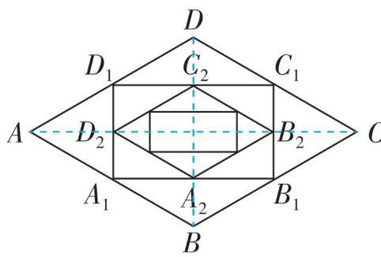
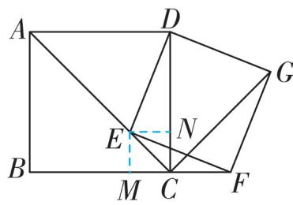

> [!success]- 必刷题
>
> > [!success] **【答案】** B
>
> > [!note]- **【解析】**
> > 连接 AC, BD, 如图. ∵ 点 $A_{1}, B_{1}$ 分别是 AB 和 BC 的中点, 点 $C_{1}, D_{1}$ 分别是 CD 和 AD 的中点, ∴ $A_{1}B_{1}$ 是 $\triangle ABC$ 的中位线, $C_{1}D_{1}$ 是 $\triangle ACD$ 的中位线, ∴ $A_{1}B_{1} // AC, A_{1}B_{1} = \frac{1}{2}AC, C_{1}D_{1} // AC, C_{1}D_{1} = \frac{1}{2}AC, ∴ A_{1}B_{1} // C_{1}D_{1}, A_{1}B_{1} = C_{1}D_{1}, ∴$ 四边形 $A_{1}B_{1}C_{1}D_{1}$ 是平行四边形. 又∵ 四边形 ABCD 是菱形, ∴ $AC \perp BD$ . ∵ $A_{1}, D_{1}$ 分别是 AB, AD 的中点, ∴ $A_{1}D_{1}$ 是 $\triangle ABD$ 的中位线, ∴ $A_{1}D_{1} // DB, ∴ A_{1}D_{1} \perp C_{1}D_{1}, ∴ \angle A_{1}D_{1}C_{1} = 90^{\circ}, ∴$ 四边形 $A_{1}B_{1}C_{1}D_{1}$ 是矩形. ∵ 四边形 ABCD 是菱形, ∴ AD = AB. ∵ $AD_{1} = \frac{1}{2}AD, AA_{1} = \frac{1}{2}AB, ∴ AD_{1} = AA_{1}.$
> >
> > 易错警示
> > 可按照四边形→
> > 平行四边形→
> > 矩形（菱形）
> > →正方形的顺序依次添加条件,使四边形ABCD为正方形.不可混淆特殊四边形的判定.
> >
> > ## 思路分析
> >
> > 若四边形 $AB-CD$ 是边长为1的正方形，根据 $AB = BC = CD = AD = 1$ ，求出 $AQ$ 和 $AP$ 的值，根据勾股定理求出 $PQ$ 的值，即可判断甲是否正确，若四边形 $PQMN$ 为正方形，根据边的关系可以求出 $AB = AD = 1$ ，即可判断乙是否正确.
> >
> > $\because \angle DAB = 60^{\circ}, \therefore \triangle D_{1}AA_{1}$ 是等边三角形. 又 $\because AA_{1} = \frac{1}{2} AB = 1, \therefore A_{1}D_{1} = AA_{1} = 1.$ 易得 $C_{1}D_{1} = \sqrt{3}, \therefore$ 四边形 $A_{1}B_{1}C_{1}D_{1}$ 的面积为 $\sqrt{3}$ ; 依次类推, 四边形 $A_{2}B_{2}C_{2}D_{2}$ 的面积为 $\frac{\sqrt{3}}{2}$ ; 四边形 $A_{3}B_{3}C_{3}D_{3}$ 的面积为 $\frac{\sqrt{3}}{2^{2}}; \cdots, \therefore$ 四边形 $A_{n}B_{n}C_{n}D_{n}$ 的面积为 $\frac{\sqrt{3}}{2^{n-1}}$ . 故选 B.
> >
> > 
> > (第2题图)
> >
> > 
> > (第3题图)
