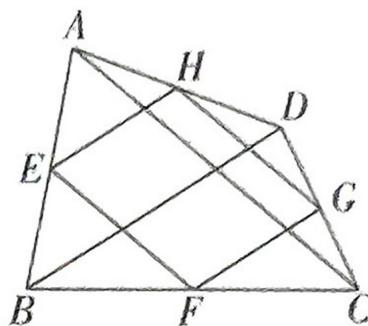

## 课时 2 正方形的判定 刷基础

## 刷基础

## 知识点 1 正方形的判定

![[初中/课堂同步/教辅/必刷题/2026《初中必刷题》数学北师9上/01_第一章_特殊平行四边形/课时_2_正方形的判定/questions/Q00107763.md]]
![[初中/课堂同步/教辅/必刷题/2026《初中必刷题》数学北师9上/01_第一章_特殊平行四边形/课时_2_正方形的判定/questions/Q00107347.md]]
![[初中/课堂同步/教辅/必刷题/2026《初中必刷题》数学北师9上/01_第一章_特殊平行四边形/课时_2_正方形的判定/questions/Q00107348.md]]

## 知识点2 中点四边形

![[初中/课堂同步/教辅/必刷题/2026《初中必刷题》数学北师9上/01_第一章_特殊平行四边形/课时_2_正方形的判定/questions/Q00107349.md]]

## 建议说明 25 分钟 编号 D14

A. 若 $AC = BD$ , 则四边形 $EFGH$ 为菱形
B. 若 $AC \perp BD$ , 则四边形 $EFGH$ 为矩形
C. 若 $AC = BD$ , 且 $AC \perp BD$ , 则四边形 $EFGH$ 为正方形

D. 若 $AC$ 与 $BD$ 互相平分, 且 $AC = BD$ , 则四边形 $EFGH$ 是正方形

## 知识点 3 正方形的性质与判定的综合

![[初中/课堂同步/教辅/必刷题/2026《初中必刷题》数学北师9上/01_第一章_特殊平行四边形/课时_2_正方形的判定/questions/Q00107350.md]]

## 易错点 将特殊四边形的判定混淆导致出错

![[初中/课堂同步/教辅/必刷题/2026《初中必刷题》数学北师9上/01_第一章_特殊平行四边形/课时_2_正方形的判定/questions/Q00107764.md]]
