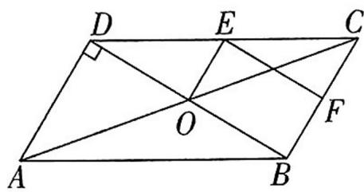

<!-- question-source:start -->
2[2025 陕西咸阳质检]如图,在□ABCD中,对角线AC,BD相交于点O,AD⊥DB,点E,F分别是CD,BC的中点,连接OE,EF.求证:四边形OEFB是矩形.

建议用时 20 分钟 答案 D8

丁:量得窗框的两组对边分别相等且两条对角线相等.
检测后,他们都判断该窗框是矩形,则检测方法正确的同学是\_\_\_\_.
<!-- question-source:end -->

![[Q00107320A1]]
