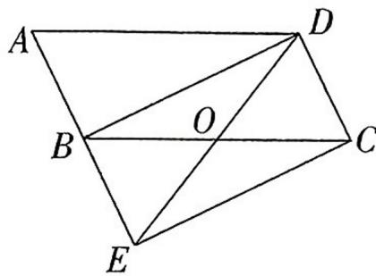

<!-- question-source:start -->
5[2024 重庆沙坪坝区调研]如图, 将 $\square ABCD$ 的边 $AB$ 延长至点 $E$ , 使 $BE = AB$ , 连接 $DE, EC, BD, DE$ 交 $BC$ 于点 $O$ .

(1)求证: $\triangle ABD \cong \triangle BEC$ ;

(2) 若 $\angle BOD = 2\angle A$ , 求证: 四边形 $BECD$ 是矩形.

<!-- question-source:end -->

![[Q00107321A1]]
