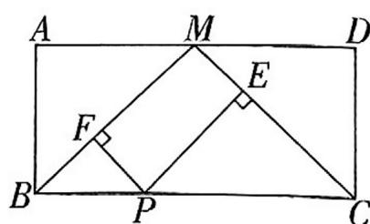

<!-- question-source:start -->
6[2024 陕西西安调研]如图,在矩形 ABCD 中,M

为 $AD$ 边的中点, $P$ 为 $BC$ 上一点, $PE \perp MC$ , $PF \perp MB$ , 当 $AB, BC$ 满足条件 \_\_\_\_ 时, 四边形 $PEMF$ 为矩形.

<!-- question-source:end -->

![[Q00107324A1]]
