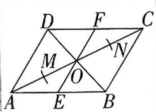
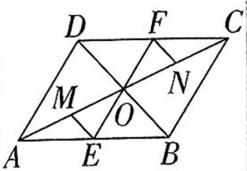
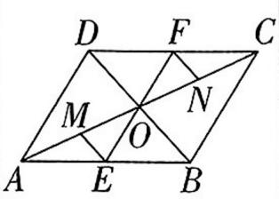

<!-- question-source:start -->
2[2025 山西吕梁期末, 中] □ABCD 中, EF 经过两条对角线的交点 O, 分别交 AB, CD 于点 E, F, 在对角线 AC 上通过作图得到点 M, N, 如图(1), 图(2), 图(3), 下面关于以点 F, M, E, N 为顶点的四边形的形状的说法正确的是 ( )

<table><tr><td></td><td></td><td></td></tr><tr><td>图(1)</td><td>图(2)</td><td>图(3)</td></tr><tr><td>以点O为圆心,OE的长为半径作弧,交AC于点M,N</td><td>分别作△AOE,△COF中OA,OC边上的中线EM,FN</td><td>分别作△AOE,△COF中∠AEO,∠CFO的平分线EM,FN</td></tr></table>

C. 图(1)为平行四边形, 图(2)、图(3)为矩形
D. 图(1)为矩形, 图(2)、图(3)为平行四边形
<!-- question-source:end -->

![[Q00107326A1]]
