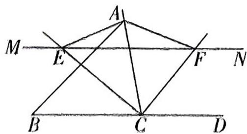

<!-- question-source:start -->
3[2025 山东泰安调研, 中]如图, 在 $\triangle ABC$ 中, 直线 $MN$ 以每秒 1 个单位的速度从 $\triangle ABC$ 的边 $BC$ 所在直线的位置出发, 沿 $CA$ 方向平移, 交 $\angle ACB$ 的平分线于点 $E$ , 交 $\triangle ACB$ 外角 $\angle ACD$ 的平分线于点 $F$ . 若 $AC = 6$ , 则当直线 $MN$ 运动了 \_\_\_\_ 秒时, 四边形 $AECF$ 是矩形.

不愧是我鸭
<!-- question-source:end -->

![[Q00107327A1]]
