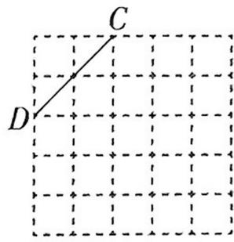

<!-- question-source:start -->
4[2025 黑龙江哈尔滨质检, 中]如图, $5 \times 5$ 的正方形网格中, 每个小正方形的边长均为 1. 线段 CD 的端点在小正方形的顶点上, 在图中画一个以线段 CD 为一边的矩形 CDMN, 使矩形 CDMN 的面积是 12, 并直接写出 DN 的长. (要求: 所画图形的顶点 M, N 都在小正方形的顶点上)

<!-- question-source:end -->

![[Q00107328A1]]
