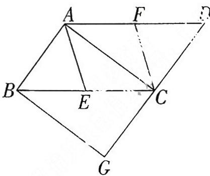

<!-- question-source:start -->
5 [2025 上海虹口区期末, 中] 如图, 在 $\square ABCD$ 中, $E, F$ 分别是边 $BC, AD$ 的中点, 连接 $AE, CF$ , $AC$ 平分 $\angle DAE$ .

(1) 求证: 四边形 $AECF$ 是菱形;

(2) 在 $BC$ 下方作 $\angle CBG = \angle CAE$ , $BG$ 与 $DC$ 的延长线交于点 $G$ . 求证: 四边形 $ABGC$ 是矩形.

<!-- question-source:end -->

![[Q00107329A1]]
