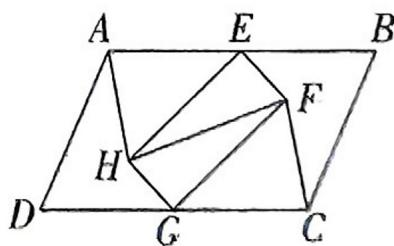

<!-- question-source:start -->
6[2024 广东深圳福田区调研, 较难]如图, 在 $\square ABCD$ 中, $E, G$ 分别是 $AB, CD$ 的中点, 且 $AH = CF, AH // CF$ .

(1) 求证: $\triangle AEH \cong \triangle CGF$ ;

(2) 连接 $FH, HG, EF$ , 若 $FH = AD$ , 求证: 四边形 $EFGH$ 是矩形.

<!-- question-source:end -->

![[Q00107330A1]]
