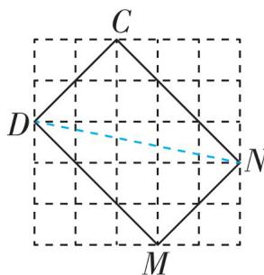

> [!success]- 必刷题
>
> > [!success] **【答案】** 详见解析
>
> > [!note]- **【解析】**
> > 【解】如图,矩形 CDMN 即为所求,连接 DN. ▶关键点拨
> >
> > DN 的长为 $\sqrt{26}$ . 由网格的特点可知, $\angle CDM = \angle DMN = \angle MNC = 90^{\circ}$ , ∴ 四边形
> >
> > CDMN 为矩形. 由勾股定理,得 $CD = 2\sqrt{2}$ ,
> >
> > $DM = 3\sqrt{2}, \therefore$ 矩形 $CDMN$ 的面积为 $2\sqrt{2} \times 3\sqrt{2} = 12$ , 满足题意. 由勾股定理, 得 $DN = \sqrt{(2\sqrt{2})^2 + (3\sqrt{2})^2} = \sqrt{26}$ .
> >
> > 关键点拨
> > 根据矩形的判定方法,结合面积公式以及网格特点,画出矩形 CDMN 是解题关键.
> >
> > 
