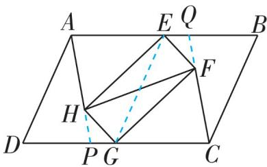
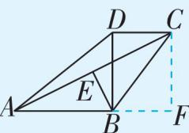

> [!success]- 必刷题
>
> > [!success] **【答案】** 详见解析
>
> > [!note]- **【解析】**
> > 【证明】(1)延长 $AH$ 交 $CD$ 于点 $P$ , 延长 $CF$ 交 $AB$ 于 $Q$ , 如图所示. $\because$ 四边形 $ABCD$ 是平
> >
> > 
> >
> > 如图, 过点 C 作 $CF \perp AB$ , 交 AB 的延长线于点 F, 根据题意可判定四边形 BFCD 是矩形, 则有 $BF = CD = 3$ , $CF = BD = 4$ , 再由勾股定理求得 BC = 5, $AC = 4\sqrt{5}$ , 从而可得出 $\triangle ABC$ 是等腰三角形, 则有 $BE \perp AC$ , 利用三角形的等面积法可求解.
> >
> > 行四边形, $\therefore AB \parallel CD, AB = CD, \therefore AQ \parallel CP$ . $\because AH \parallel CF, \therefore$ 四边形 $APCQ$ 是平行四边形, $\therefore \angle HAE = \angle FCG$ . $\because E, G$ 分别是 $AB, CD$ 的中点, $\therefore AE = \frac{1}{2} AB, CG = \frac{1}{2} CD, \therefore AE = CG = DG$ . 在 $\triangle AHE$ 和 $\triangle CFG$ 中, $\left\{ \begin{array}{l} AE = CG, \\ \angle HAE = \angle FCG, \\ AH = CF, \end{array} \right.$ $\therefore \triangle AHE \cong \triangle CFG(SAS)$ . (2) 如图, 连接 $EG$ . $\because AH \parallel CF, \therefore \angle AHF = \angle HFC$ . 由(1)得 $\triangle AHE \cong \triangle CFG, \therefore \angle AHE = \angle CFG, HE = FG, \therefore \angle AHF - \angle AHE = \angle HFC -$ $\angle CFG$ ，即 $\angle EHF = \angle GFH, \therefore HE \parallel FG, \therefore$ 四边形 $EFGH$ 是平行四边形. 由(1)得 $AE = DG, AB \parallel CD, \therefore$ 四边形 $ADGE$ 是平行四边形， $\therefore AD = EG.$ 又 $\because FH = AD, \therefore EG = FH, \therefore$ 四边形 $EFGH$ 是矩形.
> >
> > 
> >
> > ## 课时 3 矩形的性质与判定的综合应用
