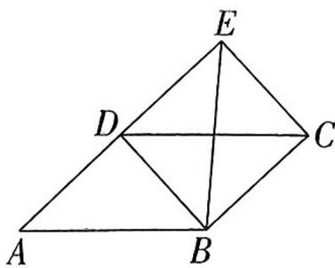

## 课时 2 矩形的判定 刷提升

[2025 甘肃白银校级质检, 中] 如图, 四边形 ABCD 为平行四边形, 延长 AD 到 E, 使 DE = AD, 连接 EB, EC, DB, 添加一个条件, 不能使四边形 DBCE 成为矩形的是 ( )

边形 DBCE 成为
A. AB = BE
B. $BE \perp DC$ C. $\angle ADB = 90^{\circ}$ D. $CE \perp DE$

![[初中/课堂同步/教辅/必刷题/2026《初中必刷题》数学北师9上/01_第一章_特殊平行四边形/课时_2_矩形的判定/questions/Q00107326.md]]
![[初中/课堂同步/教辅/必刷题/2026《初中必刷题》数学北师9上/01_第一章_特殊平行四边形/课时_2_矩形的判定/questions/Q00107327.md]]
![[初中/课堂同步/教辅/必刷题/2026《初中必刷题》数学北师9上/01_第一章_特殊平行四边形/课时_2_矩形的判定/questions/Q00107328.md]]
![[初中/课堂同步/教辅/必刷题/2026《初中必刷题》数学北师9上/01_第一章_特殊平行四边形/课时_2_矩形的判定/questions/Q00107329.md]]
![[初中/课堂同步/教辅/必刷题/2026《初中必刷题》数学北师9上/01_第一章_特殊平行四边形/课时_2_矩形的判定/questions/Q00107330.md]]
