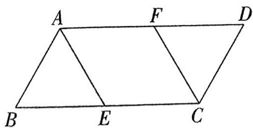

<!-- question-source:start -->
4 如图, 平行四边形 $ABCD$ 中, $AE$ , $CF$ 分别是 $\angle BAD$ , $\angle BCD$ 的平分线, 且 $E$ , $F$ 分别在边 $BC$ , $AD$ 上, $AE = AF$ .

求证: 四边形 AECF 是菱形.

<!-- question-source:end -->

![[Q00107296A1]]
