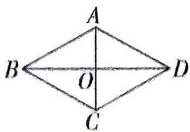

<!-- question-source:start -->
5 [2024 陕西咸阳秦都区调研] 如图, □ABCD 的对角线 AC 与 BD 相交于点 O, 添加建议用时 20 分钟 答案 D3

下列条件不能证明□ABCD 是菱形的是（ ）
A. $\angle ABD = \angle ADB$ B. $AC \perp BD$ C. AB = BC D. AC = BD
<!-- question-source:end -->

![[Q00107297A1]]
