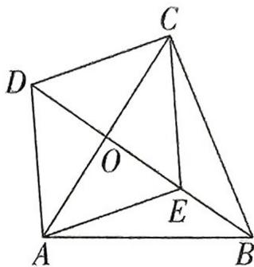

<!-- question-source:start -->
6[2025 陕西咸阳期中]如图,在四边形 ABCD 中,对角线 AC 与 BD 相交于点 O,BD 垂直平分 AC,点 E 是 OB 上一点,且 $\angle AEO = \angle CDO$ . 求证:四边形 AECD 是菱形.

<!-- question-source:end -->

![[Q00107298A1]]
