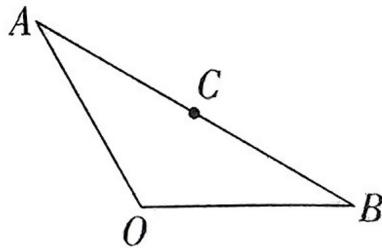

<!-- question-source:start -->
7 [2025 河南郑州期中] 如图, 在 $\triangle ABO$ 中, $AO = BO$ , $\angle O = 120^{\circ}$ , $C$ 是 $AB$ 的中点, 若将 $\triangle ABO$ 绕点 $C$ 逆时针旋转 $180^{\circ}$ , 则旋转前后两个三角形组成的图形是 ( )

组成的图形是
A. 等腰梯形
B. 菱形
C. 正五边形
D. 正三角形

<!-- question-source:end -->

![[Q00107299A1]]
