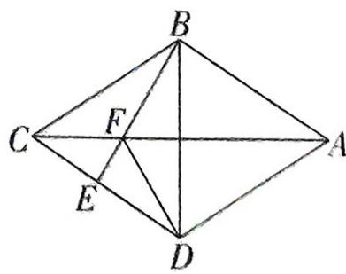

<!-- question-source:start -->
8 如图, 在四边形 $ABCD$ 中, $AC$ 是 $BD$ 的垂直平分线, $E$ 是 $CD$ 上一点, $BE$ 交 $AC$ 于 $F$ , 连接 $DF$ , $\angle BEC = \angle ADF$ , 试证明四边形 $ABCD$ 是菱形.

<!-- question-source:end -->

![[Q00107300A1]]
