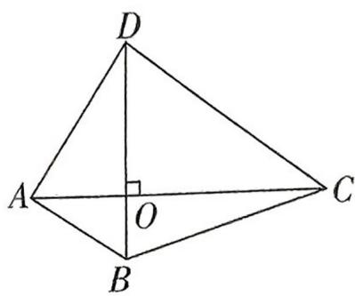
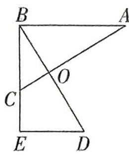

<!-- question-source:start -->
4[2025 福建厦门校级期中改编, 中]在学习了“菱形的性质与判定”后, 小明根据所学的内容, 试着定义了一个新的特殊四边形, 规定: 对角线互相垂直的四边形称为“垂美四边形”, 如图(1)所示, $AC \perp BD$ , 则四边形 $ABCD$ 为“垂美四边形”.

(1)【概念理解】证明:有三条边相等的“垂美四边形”是菱形(写出已知、求证);

(2)【性质探索】如图(1)，若记“垂美四边形”ABCD的面积为S，求出S与AC,BD之间的关系；

(3)【性质应用】小明为了证明勾股定理,尝试将两个全等的直角三角形(Rt△ABC≌Rt△BED)按图(2)方式摆放,其中B,C,E在一条直线上,若假设直角三角形三边长为x,y,z,即BC=ED=x,AB=BE=y,AC=BD=z,试利用(2)中结论证明勾股定理.

图(1)

图(2)

2刷素养 走向重高
<!-- question-source:end -->

![[Q00107302A1]]
