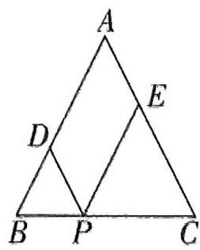
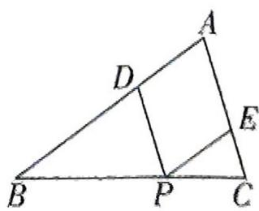

<!-- question-source:start -->
5 核心素养推理能力 [2024 河南郑州调研, 中] 如图(1), $\triangle ABC$ 为等腰三角形, $AB = AC = 6$ , $P$ 点是底边 $BC$ 上的一个动点, $PD \parallel AC$ , $PE \parallel AB$ , $D$ , $E$ 分别在 $AB$ , $AC$ 上.

(1)求四边形 ADPE 的周长.

(2) 当点 $P$ 运动到什么位置时, 四边形 ADPE 是菱形? 并说明理由.

(3)如果 $\triangle ABC$ 不是等腰三角形(如图(2)), 其他条件不变, 当点 $P$ 运动到什么位置时, 四边形 $ADPE$ 是菱形? 并说明理由.

图(1)

图(2)
<!-- question-source:end -->

![[Q00107303A1]]
