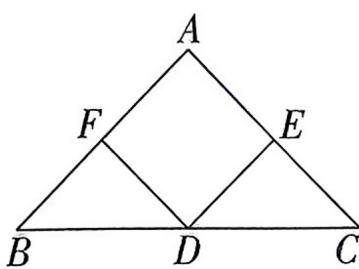

<!-- question-source:start -->
3 新考向 开放性试题 [2025 黑龙江齐齐哈尔质检]

如图, 在 $\triangle ABC$ 中, 点 $D$ , $E, F$ 分别是边 $BC, CA, AB$ 的中点, 要使四边形 $AFDE$ 为菱形, 应添加的条件是

\_\_\_\_（添加一个条件即可）.
<!-- question-source:end -->

![[Q00107744A1]]
