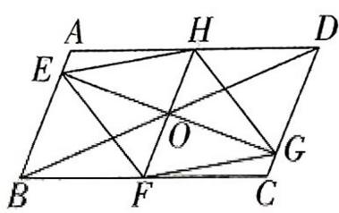
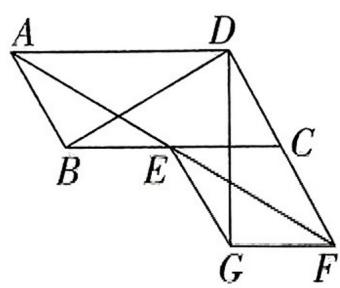

<!-- question-source:start -->
2[2025 湖北恩施州期末, 中]如图, 过□ABCD 的对角线 BD 的中点 O 作两条互相垂直的直线,分别交 AB, BC, CD, DA 于 E, F, G, H 四点, 连接 EF, FG, GH, HE, 下列结论正确的是 ( )

A. FH = AB

B. $S_{四边形 EFGH} = \frac{1}{2} S_{四边形 ABCD}$ C. $FG = \frac{1}{2} BD$ D. 四边形 EFGH 是菱形

(第2题图)

(第3题图)
<!-- question-source:end -->

![[Q00107746A1]]
