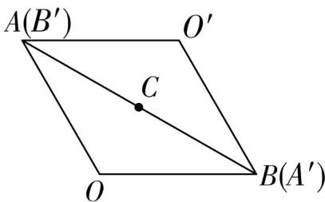
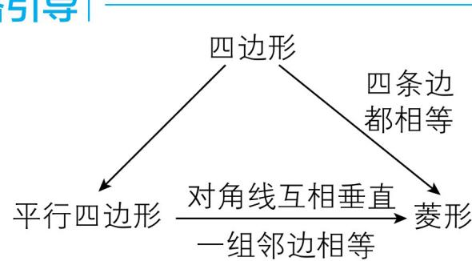

> [!success]- 必刷题
>
> > [!success] **【答案】** B
>
> > [!note]- **【解析】**
> > 如图, 由旋转可知 $AO' = BO$ , $AO = BO'$ . $\because AO = BO$ , $\therefore AO' = BO = AO =$
> >
> > 
> >
> > $BO', \therefore$ 四边形 $AOBO'$ 为菱形, 即旋转前后两个三角形组成的图形是菱形. 故选 B.
> >
> > 
> >
> > 【证明】∵ AC 是 BD 的垂直平分线, ∴ AB = AD,
> > BC = CD, ∴ ∠ABD = ∠ADB, ∠BAF = ∠DAF.
> > 在 $\triangle ABF$ 和 $\triangle ADF$ 中, $\left\{\begin{aligned}AB&=AD,\\ \angle BAF&=\angle DAF,\\ AF&=AF,\end{aligned}\right.$ ∴ $\triangle ABF \cong \triangle ADF$ (SAS), ∴ $\angle ABF = \angle ADF$ .
> > ∵ $\angle BEC = \angle ADF, \therefore \angle BEC = \angle ABF, \therefore AB \parallel CD,$ ∴ $\angle BAC = \angle ACD.$ 又∵ $\angle BAC = \angle DAC,$ ∴ $\angle CAD = \angle ACD, \therefore AD = CD.$ ∵ AB = AD, BC = CD, ∴ AB = CB = CD = AD, ∴ 四边形 ABCD 是菱形.
