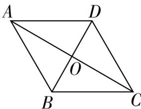

> [!success]- 必刷题
>
> > [!success] **【答案】** AC
>
> > [!note]- **【解析】**
> > (1)【解】已知:如图,四边形ABCD的两条对角线互相垂直,即 $AC \perp BD$ ,且AB = BC = CD.
> >
> > 
> >
> > 证明：∵ $AC \perp BD, \therefore \angle BOA = \angle BOC = 90^{\circ}$ .
> > 在 Rt△BOA 和 Rt△BOC 中， $\left\{\begin{aligned}OB&=OB,\\ AB&=CB,\end{aligned}\right.$ ∴ Rt△AOB≌Rt△COB(HL)，∴ OA=OC. 同理可得 Rt△COD≌Rt△COB(HL)，∴ OD=OB，
> > ∴ 四边形 ABCD 是平行四边形. ∵ AC⊥BD,
> > ∴ 四边形 ABCD 是菱形, ∴ 有三条边相等的“垂美四边形”是菱形.
> >
> > (2)【解】在题图(1)中, $\because S_{四边形ABCD}=S_{\triangle ABC}+S_{\triangle ADC}=\frac{1}{2}AC\cdot BO+\frac{1}{2}AC\cdot DO=\frac{1}{2}AC\cdot BD,$ $\therefore S=\frac{1}{2}AC\cdot BD.$
> >
> > (3)【证明】连接 $CD, AD$ . 由已知可得 $\angle BCA = \angle EDB$ . $\because \angle CBO + \angle EDB = 90^{\circ}$ , $\therefore \angle CBO + \angle BCA = 90^{\circ}$ , $\therefore AC \perp BD$ , $\therefore$ 四边形 $ABCD$ 是“垂美四边形”. 由(2)可得 $S_{\text{四边形}ABCD} = \frac{1}{2} AC \cdot BD = \frac{1}{2} z^{2}$ . $\because \angle BED = \angle ABC = 90^{\circ}$ , $\therefore$ 易知四边形 $ABED$ 为直角梯形. $\because S_{\text{四边形}ABCD} = S_{\text{梯形}ABED} - S_{\triangle CED} = (x + y) \times y \times \frac{1}{2} - \frac{1}{2} \times x \times (y - x) = \frac{1}{2} y^{2} + \frac{1}{2} xy + \frac{1}{2} x^{2} - \frac{1}{2} xy = \frac{1}{2} y^{2} + \frac{1}{2} x^{2}, \therefore \frac{1}{2} z^{2} =$ $\frac{1}{2} y^{2} + \frac{1}{2} x^{2}$ , 即 $z^{2} = y^{2} + x^{2}$ , 即勾股定理得证. 刷素养
