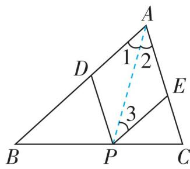

> [!success]- 必刷题
>
> > [!success] **【答案】** D
>
> > [!note]- **【解析】**
> > 【解】(1)∵PD∥AC,PE∥AB,∴∠DPB=∠C,
> > ∠EPC=∠B.∵AB=AC,∴∠B=∠C,∴∠B=
> > ∠DPB=∠C=∠EPC,∴DB=DP,PE=EC,
> > ∴四边形ADPE的周长是AD+DP+PE+AE=
> > AB+AC=6×2=12.
> >
> > (2) 当点 $P$ 运动到 $BC$ 中点时, 四边形 $ADPE$ 是菱形. 理由如下: $\because PD \parallel AC, PE \parallel AB, \therefore$ 四边形 $ADPE$ 是平行四边形. $\because$ 点 $P$ 是 $BC$ 的中点, $\therefore PB = PC$ . 在 $\triangle DBP$ 和 $\triangle ECP$ 中, $\angle B = \angle C, BP = CP$ , 由 (1) 知 $\angle DPB = \angle EPC$ , $\therefore \triangle DBP \cong \triangle ECP(\text{ASA}), \therefore DP = PE, \therefore$ 平行四边形 $ADPE$ 是菱形. (3) 如图, 点 $P$ 运动到 $\angle A$ 的平分线上时, 四边形 $ADPE$ 是菱形. 理由如下: 连接 $AP$ .
> >
> > ∵ $PD \parallel AC, PE \parallel AB, \therefore$ 四边形 ADPE 是平行四边形. ∵ AP 平分 $\angle BAC,$ ∴ $\angle1 = \angle2.$ ∵ $AB \parallel EP,$ ∴ $\angle1 = \angle3, \therefore \angle2 = \angle3,$
> >
> > 
> >
> > 关键点拨
> > (2) 由 $PD \parallel AC, PE \parallel AB$ , 可得四边形 ADPE 是平行四边形, 要使四边形 ADPE 是菱形, 只需使一组邻边相等即可, 由此可得出点 P 的位置.
> >
> > $\therefore AE = EP, \therefore$ 平行四边形 $ADPE$ 是菱形.
> >
> > ## 课时 3 菱形的性质与判定的综合应用
