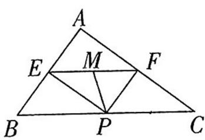
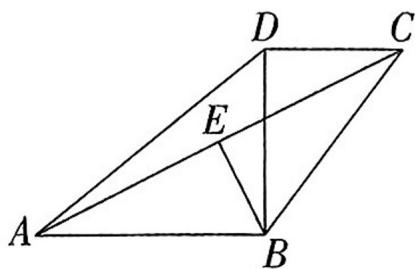

<!-- question-source:start -->
1 [中] 如图, 在 $\triangle ABC$ 中, $\angle BAC = 90^{\circ}$ , $AB = 6$ , $AC = 8$ , $P$ 为边 $BC$ 上一动点, $PE \perp AB$ 于 $E$ , $PF \perp AC$ 于 $F$ , $M$ 为 $EF$ 的中点, 则 $PM$ 的最小值为 ( )
A. 5 B. 2. 5 C. 4. 8 D. 2. 4

(第1题图)

(第2题图)
<!-- question-source:end -->

![[Q00107331A1]]
