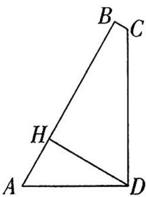
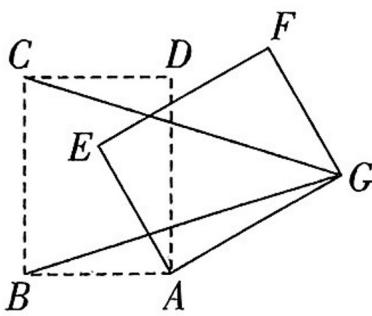

<!-- question-source:start -->
3[2024 福建福州期中, 中]如图, 在四边形 $ABCD$ 中, $\angle A = 60^{\circ}$ , $\angle ABC = \angle ADC = 90^{\circ}$ , $BC = 1$ , $CD = 10$ , 过 $D$ 作 $DH \perp AB$ 于 $H$ , 则 $DH$ 的长是 \_\_\_\_.

(第3题图)
(第4题图)
<!-- question-source:end -->

![[Q00107333A1]]
