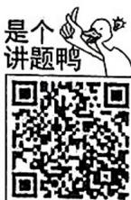

<!-- question-source:start -->
4[中]如图,已知矩形 $ABCD, AB = 6$ , $AD = 8$ , 将矩形 $ABCD$ 绕点 $A$ 顺时针旋转 $\theta (0^{\circ} < \theta < 360^{\circ})$ 得到矩形 $AEFG$ , 连接 $CG, BG$ . 当 $\theta =$ \_\_\_\_ 时, $GC = GB$ .

<!-- question-source:end -->

![[Q00107334A1]]
