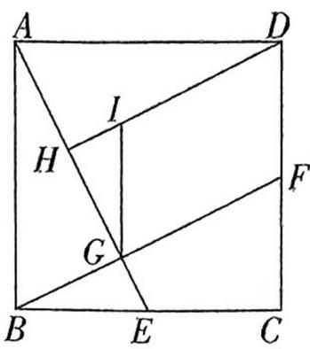
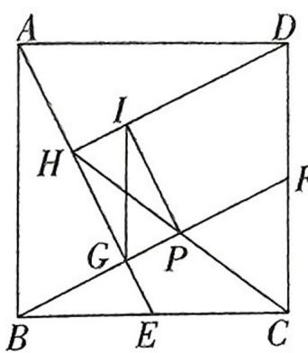

<!-- question-source:start -->
5[2025 福建福州期末,较难]如图(1),矩形ABCD中,E为BC中点,连接AE,BF⊥AE于点G,交CD于F,DH⊥AE于点H,GI∥CD,交DH于点I.

(1) 求证: GI = DF;

(2) 若 $DF = FG$ , 求证: $A, I, F$ 三点共线;

(3)如图(2),连接 $HC$ 交 $BF$ 于点 $P$ ,连接 $PI$ ,求证:四边形 $GPIH$ 是矩形.

图(1)

图(2)
<!-- question-source:end -->

![[Q00107335A1]]
