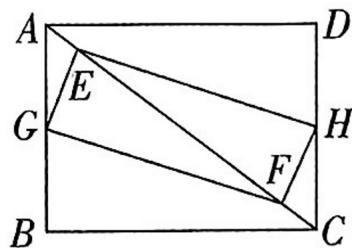
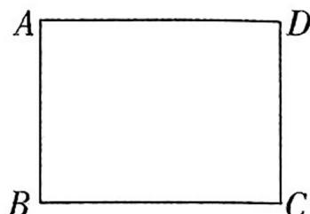

<!-- question-source:start -->
6 核心素养几何直观 [较难] 如图, 矩形 $ABCD$ 中, $AB = 6 \mathrm{~cm}, BC = 8 \mathrm{~cm}, E, F$ 是对角线 $AC$ 上的两个动点, 分别从 $A, C$ 同时出发, 相向而行, 速度均为 $2 \mathrm{~cm} / \mathrm{s}$ , 运动时间为 $t (0 \leqslant t \leqslant 5) \mathrm{~s}$ .

(1) 若 $G, H$ 分别是 $AB, DC$ 的中点, 且 $t \neq 2.5$ , 求证: 以 $E, G, F, H$ 为顶点的四边形始终是平行四边形.

(2)在(1)的条件下,当t为何值时,以E,G,F,H为顶点的四边形是矩形?

备用图

电子错题本鸭
<!-- question-source:end -->

![[Q00107336A1]]
