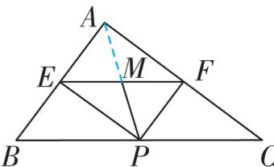

> [!success]- 必刷题
>
> > [!success] **【答案】** D
>
> > [!note]- **【解析】**
> > 连接 AM, 如图所示. ∵ ∠BAC =
> >
> > $$
> > 90^{\circ}, A B = 6, A C = 8
> > $$
> >
> > $$
> > \therefore B C = \sqrt {6 ^ {2} + 8 ^ {2}} = 1 0.
> > $$
> >
> > $$
> > \because P E \perp A B, P F \perp A C
> > $$
> >
> > 
> >
> > ∴ 四边形 AFPE 是矩形, ∴ A, M, P 三点共线, EF = AP, EF 与 AP 互相平分, ∴ M 为 AP 的中点, ∴ $PM = \frac{1}{2}AP$ . 当 $AP \perp BC$ 时, AP 最小, 此时 PM 也最小, $AP = \frac{AB \times AC}{BC} = 4.8$ , ∴ AP 的最小值为 4.8, ∴ 当 PM 最小时, $PM = \frac{1}{2}AP = 2.4$ .
> >
> > 故选 **D**.
