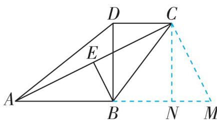
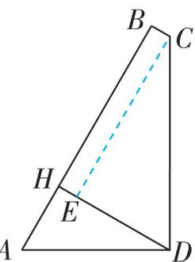

> [!success]- 必刷题
>
> > [!success] **【答案】** C
>
> > [!note]- **【解析】**
> > 延长 $AB$ , 在 $AB$ 的延长线上截取
> >
> > BM = AB, 连接 CM,
> > 过点 C 作 $CN \perp AB$ ,
> > 交 AB 延长线于点
> > N, 如图.∵AB//CD,
> >
> > 
> >
> > $AB \perp BD, \therefore CD \perp BD. \because CN \perp AB, \therefore CN \perp CD,$ ∴ 四边形 BNCD 是矩形，∴ $BN = CD = 3, CN = BD = 4, \therefore NM = BM - BN = 2.$ 在 Rt $\triangle CNM$ 中， $CM=\sqrt{CN^{2}+NM^{2}}=\sqrt{4^{2}+2^{2}}=2\sqrt{5}.$ 点 E 是 AC 的中点，AB=BM，∴ BE 是 $\triangle ACM$ 的中位线，∴ $BE=\frac{1}{2}CM=\sqrt{5}$ . 故选 C.
> >
> > 添加辅助线
> > 注意到条件中的 $\angle ABC = \angle ADC = \angle DHB = 90^{\circ}$ , 则考虑过 $C$ 作 $CE \perp DH$ 于 $E$ , 构造矩形 $BCEH$ , 得 $HE = BC = 1$ , 再由直角转化 $30^{\circ}$ 角, 用含 $30^{\circ}$ 角的直角三角形的性质求得 $DE$ 的长.
> >
> > 【解析】如图, 过 C 作 $CE \perp DH$ 于 E, 则 $\angle CEH = \angle CED = 90^{\circ}$ .
> > ∵ $DH \perp AB$ , ∴ $\angle AHD = \angle BHE = 90^{\circ}$ . ∵ $\angle ABC = 90^{\circ}$ ,
> > ∴ 四边形 BCEH 是矩形，$\therefore HE = BC = 1.$ 在 Rt $\triangle AHD$ 中， $\angle A = 60^{\circ}$ ， $\therefore \angle ADH = 90^{\circ} - \angle A = 30^{\circ}$ . 又 $\because \angle ADC = 90^{\circ}$ ， $\therefore \angle CDE = 90^{\circ} - \angle ADH = 60^{\circ}, \therefore \angle DCE = 90^{\circ} - \angle CDE = 30^{\circ}, \therefore DE = \frac{1}{2} CD = 5, \therefore DH = HE + DE = 6.$
> >
> > 
