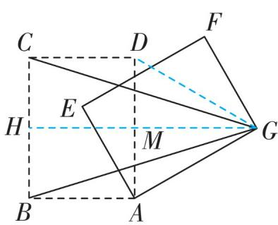
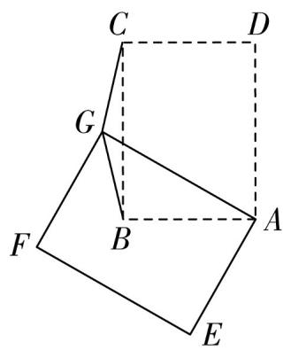

> [!success]- 必刷题
>
> > [!success] **【答案】** $60^{\circ}$ 或 $300^{\circ}$
>
> > [!note]- **【解析】**
> > 当 GB = GC 时, 点 G 在 BC 的垂直平分线上. 分两种情况讨论:
> > - **①**：如图(1), 当点 G 在 AD 右侧时, 取 BC 的中点 H, 连接 GH 交 AD 于 M, 连接 GD. ∵ GC = GB, ∴ GH ⊥ BC, ∴ 四边形 ABHM 是矩形, ∴ AM = BH = $\frac{1}{2}$ AD, ∴ GM 垂直平分 AD, ∴ GD = GA = DA, ∴ $\triangle ADG$ 是等边三角形, ∴ $\angle DAG = 60^{\circ}$ , ∴ 旋转角 $\theta = 60^{\circ}$ .
> >
> > 关键点拨
> > 当 GB = GC
> > 时, 点 G 在 BC
> > 的垂直平分线上, 分两种情况讨论: 点 G
> > 在 AD 右侧和点 G 在 AD
> > 左侧.
> >
> > 
> >
> > 
> > 图(1)
> > 图(2)
> > - **②**：如图(2), 当点 $G$ 在 $AD$ 左侧时, 同理可得 $\angle DAG = 60^{\circ}$ , $\therefore$ 旋转角 $\theta = 360^{\circ} - 60^{\circ} = 300^{\circ}$ . 故答案为 $60^{\circ}$ 或 $300^{\circ}$ .
