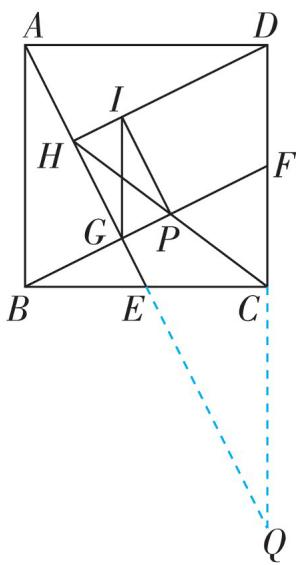

> [!success]- 必刷题
>
> > [!success] **【答案】** 详见解析
>
> > [!note]- **【解析】**
> > 【证明】(1)∵ $BF \perp AE, DH \perp AE, \therefore BF \parallel DH$ ，即 $GF \parallel DI.$ 又∵ $GI \parallel CD, \therefore$ 四边形 DFGI 是平行四边形，∴ GI = DF.
> > (2) 连接 DG, AF, IF. 由 (1) 得四边形 DFGI 是平行四边形. ∵ DF = FG, ∴ 平行四边形 DFGI 是菱形, ∴ FI 是 DG 的垂直平分线. 在矩形 ABCD 中, $\angle ADF = 90^{\circ}$ . ∵ $BF \perp AE, \therefore \angle AGF = 90^{\circ} = \angle ADF, \therefore Rt \triangle ADF \cong Rt \triangle AGF(HL), \therefore AD = AG, \therefore$ 点 A 在 DG 的垂直平分线上, ∴ A, I, F 三点共线.
> >
> > (3)延长 AE, DC 交于点 Q，如图。在矩形 ABCD 中， $AB = DC, \angle ABE = \angle BCD = \angle ECQ = 90^{\circ}$ 。∵ E 为 BC 中点，∴ BE = CE。∵ ∠AEB = ∠QEC，∴ △ABE ≅ △QCE（ASA），∴ CQ = BA = CD，∴ C 为 DQ 中点。又∵ AE ⊥ BF，DH ⊥ AE，∴ ∠FGH =
> >
> > 技巧点拨动点问题可以在草稿纸上画出动点运动到不同位置时的图形以理解运动变化, 还可以直接画出运动到题目所要求的位置时的图形以方便求解.
> >
> > 
> >
> > $\angle DHQ = 90^{\circ}, \therefore$ 在 Rt $\triangle DHQ$ 中, $HC = \frac{1}{2} DQ = CD, \therefore \angle CHD = \angle CDH$ . 由 (1) 得, 四边形 DFGI 是平行四边形, $\therefore \angle IGF = \angle CDI, \therefore \angle IGF = \angle CHD, \therefore 90^{\circ} - \angle IGF = 90^{\circ} - \angle CHD$ , 即 $\angle IGH = \angle PHG$ . $\because \angle PGH = \angle IHG = 90^{\circ}, HG = GH, \angle PHG = \angle IGH, \therefore \triangle PGH \cong \triangle IHG(\text{ASA}), \therefore IH = PG$ . 又 $\because IH // PG, \therefore$ 四边形 IHGP 是平行四边形. 又 $\because \angle DHQ = 90^{\circ}, \therefore$ 平行四边形 IHGP 是矩形.
> >
> > ## 刷素养·
