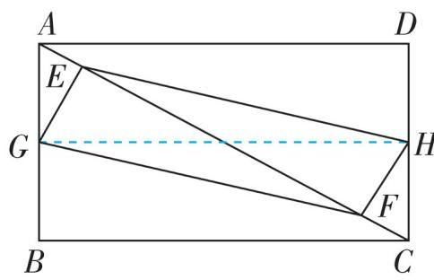

> [!success]- 必刷题
>
> > [!success] **【答案】** (1)
>
> > [!note]- **【解析】**
> > 【证明】∵四边形ABCD是矩形, ∴ AB = CD, AB // CD, AD // BC, ∠B = 90°, ∴ ∠BAC = ∠DCA. ∵ AB = 6 cm, BC = 8 cm, ∴ AC = 10 cm.
> >
> > ∵G,H分别是AB,DC的中点, ∴ AG = $\frac{1}{2}$ AB,
> >
> > CH = $\frac{1}{2}$ CD, ∴ AG = CH. ∵ E,F 是对角线AC上的两个动点, 分别从A,C同时出发, 相向而行, 速度均为2 cm/s, ∴ AE = CF, ∴ AF = CE,
> >
> > ∴ △AGF ≅ △CHE(SAS), ∴ GF = HE, ∠AFG = ∠CEH, ∴ GF // HE, ∴ 以E,G,F,H为顶点的四边形始终是平行四边形.
> >
> > (2)【解】如图, 连接 GH, 由 (1) 可知四边形 EGFH 是平行四边形.
> > ∵ G, H 分别是
> >
> > 
> >
> > $AB, DC$ 的中点, $\therefore GH = BC = 8\mathrm{cm}, \therefore$ 当 $EF = GH = 8\mathrm{cm}$ 时, 四边形 $EGFH$ 是矩形, 分两种情况: 由题知, $AE = CF = 2t$ .
> > - **①**：若 $E, F$ 相遇前, $EF = 8$ , 则 $EF = 10 - 4t = 8$ , 解得 $t = 0.5$ ;
> > - **②**：若 $E, F$ 相遇后, $EF = 8$ , 则 $EF = 2t + 2t - 10 = 8$ , 解得 $t = 4.5$ .
> > 即当 $t$ 为 4.5 或 0.5 时, 以 $E, G, F, H$ 为顶点的四边形是矩形.
> >
> > ## 3 正方形的性质与判定
> >
> > ## 课时1 正方形的性质
