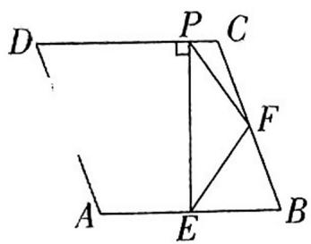
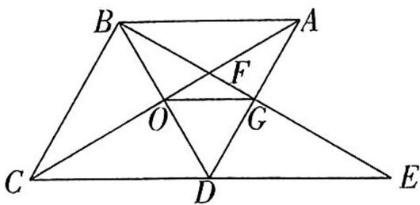

<!-- question-source:start -->
1 [2024 河北衡水冀州区期末, 中] 如图, 平行四边形 $ABCD$ 中, $\angle A = 110^{\circ}, AD = DC$ . $E, F$ 分别是边 $AB$ 和 $BC$ 的中点, $EP \perp CD$ 于点 $P$ , 连接 $PF$ , $EF$ , 则 $\angle PEF =$ ( )
A. $35^{\circ}$ B. $45^{\circ}$ C. $50^{\circ}$ D. $55^{\circ}$

(第1题图)

(第2题图)
<!-- question-source:end -->

![[Q00107304A1]]
