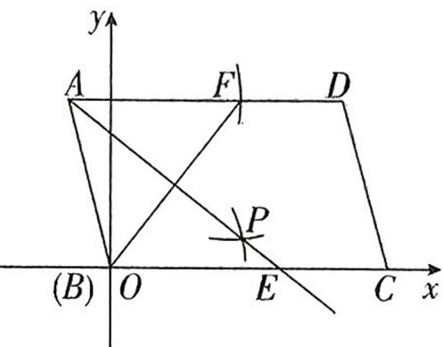

<!-- question-source:start -->
4[2025 辽宁沈阳期中, 中]如图, 平面直角坐标系中, 平行四边形 $ABCD$ 的顶点 $B$ 与原点 $O$ 重合, 顶点 $C$ 落在 $x$ 轴的正半轴上, 在 $AD$ 上截取

$AF=AB$ , 分别以点 B, F 为圆心, 大于 $\frac{1}{2}BF$ 的长为半径画弧, 两弧交于点 P, 射线 AP 交 BC 于 E, 若 AB=5, BF=6, 则点 F 的坐标为 \_\_\_\_.

<!-- question-source:end -->

![[Q00107306A1]]
