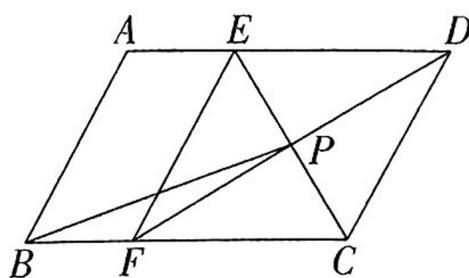

<!-- question-source:start -->
5 [2024 浙江杭州拱墅区调研, 中] 如图, 在 $\square ABCD$ 中, $CE$ 平分 $\angle BCD$ , 交 $AD$ 于点 $E$ , $DF$ 平分 $\angle ADC$ , 交 $BC$ 于点 $F$ , $CE$ 与 $DF$ 交于点 $P$ , 连接 $EF$ , $BP$ .

(1) 求证: 四边形 CDEF 是菱形;

(2) 若 ${AB} = 2,{BC} = 3, \angle A = {120}^{ \circ  }$ ,求 ${BP}$ 的长.

<!-- question-source:end -->

![[Q00107307A1]]
