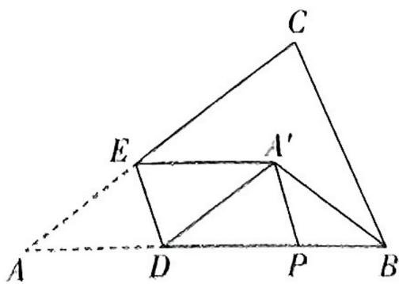

<!-- question-source:start -->
6 核心素养 几何直观 [2025 陕西西安质检, 较难] 如图所示, 三角形纸片 $ABC$ 中, $\angle A = 37^\circ$ , 将其沿 $DE$ 折叠后点 $A$ 落在 $A'$ 处, 使 $A'E \parallel AB$ , $P$ 是 $AB$ 上一动点, 连接 $BA', A'P$ . 当 $BA' + A'P$ 取最小值时, $\angle PA'B$ 的度数为 \_\_\_\_°.

电子错题本鸭
<!-- question-source:end -->

![[Q00107308A1]]
