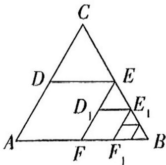

<!-- question-source:start -->
3 [中]如图, $\triangle ABC$ 是边长为 1 的等边三角形, 分别取 $AC, BC$ 边的中点 $D, E$ , 连接 $DE$ , 作 $EF \parallel AC$ 得到四边形 $EDAF$ , 它的周长记作 $C_1$ ; 分别取 $EF, BE$ 的中点 $D_1, E_1$ , 连接 $D_1E_1$ , 作 $E_1F_1 \parallel EF$ , 得到四边形 $E_1D_1FF_1$ , 它的周长记作 $C_2, \cdots$ , 照此规律作下去, 则 $C_{2023}$ 等于 \_\_\_\_.

<!-- question-source:end -->

![[Q00107749A1]]
