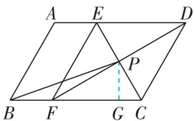

> [!success]- 必刷题
>
> > [!success] **【答案】** (1)
>
> > [!note]- **【解析】**
> > 【证明】∵四边形ABCD为平行四边形，∴AD∥BC, ∴∠EDF = ∠DFC. ∵DF平分∠ADC, ∴∠EDF = ∠CDF, ∴∠DFC = ∠CDF, ∴CD=CF, 同理可得CD=DE, ∴CF=DE. 又∵CF∥DE, ∴四边形CDEF是平行四边形. ∵CD=CF, ∴四边形CDEF为菱形.
> >
> > (2)【解】如图, 过 P 作 $PG \perp BC$ 于 G. $\because AB = 2, BC = 3, \angle A = 120^{\circ}$ ,
> > 且四边形 CDEF 为菱
> >
> > 
> >
> > 形, $\therefore CF = EF = CD = AB = 2$ , $\angle ECF = \frac{1}{2}\angle BCD = \frac{1}{2}\angle A = 60^{\circ}$ , $\therefore \triangle CEF$ 为等边三角形, $\angle CPG = 30^{\circ}$ , $\therefore CE = CF = 2$ , $\therefore PC = \frac{1}{2}CE = 1$ , $\therefore CG = \frac{1}{2}PC = \frac{1}{2}$ , $\therefore BG = BC - CG = 3 - \frac{1}{2} = \frac{5}{2}$ , 由勾股定理得, $PG = \frac{\sqrt{3}}{2}$ . 在 Rt $\triangle BPG$ 中, 由勾股定理可得 $BP = \sqrt{BG^{2} + PG^{2}} = \sqrt{\left(\frac{5}{2}\right)^{2} + \left(\frac{\sqrt{3}}{2}\right)^{2}} = \sqrt{7}$ , 即 $BP$ 的长为 $\sqrt{7}$ .
> >
> > 思路分析根据矩形的性质可得 $\angle B = \angle EHG = 90^{\circ}$ 利用三角形的外角性质可得 $\angle 3$ 的度数，然后再利用 $\angle 2 = \angle EHG-$ $\angle 3$ 即可解答.
> >
> > ## 刷素养·
