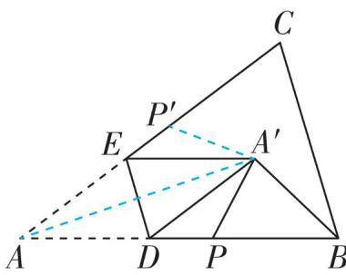

> [!success]- 必刷题
>
> > [!success] **【答案】** 37
>
> > [!note]- **【解析】**
> > 如图, 连接 A $A'E, AD = A'D, \angle AED = \angle A'ED.\because A'E \parallel AB,$ $\therefore \angle A'ED = \angle ADE,$ $\therefore \angle AED = \angle ADE,$ $\therefore AE = AD, \therefore A'E =$
> >
> > 
> >
> > $AE = AD = A'D, \therefore$ 四边形 $ADA'E$ 是菱形, $\therefore AA'$ 平分 $\angle BAC$ . 作点 $P$ 关于 $AA'$ 的对称点 $P'$ , 连接 $A' P'$ , 易知 $P'$ 在 $AC$ 上, $\therefore A' P = A' P', \therefore BA' + A' P = A' P' + A'B, \therefore$ 当 $B, A', P'$ 三点共线, 且 $BP' \perp AC$ 时, $BA' + A' P$ 的值最小, 此时 $\angle APA' = \angle AP'A' = 90^\circ, \therefore \angle BAC + \angle PA' P' = 180^\circ$ . 又 $\because \angle PA'B + \angle PA' P' = 180^\circ, \therefore \angle BAC = \angle PA'B = 37^\circ$ . 故答案为 37.
> >
> > 思路分析
> > 根据勾股定理求出 AB 的长, 即可得出 $A'B'$ 的长, 再根据直角三角形斜边上的中线等于斜边的一半求解即可.
> >
> > ## 2 矩形的性质与判定
> >
> > ## 课时 1 矩形的性质
