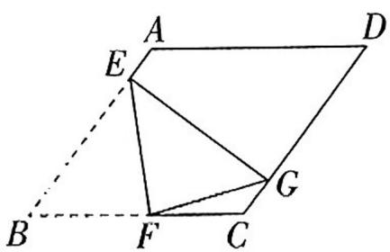
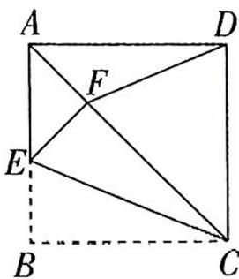

<!-- question-source:start -->
2[2025 浙江金华质检, 中]如图, 在菱形 ABCD 中, 点 E, F 分别在 AB, BC 上, 沿 EF 翻折后, 点 B 落在边 CD 上的 G 处, 若 $EG \perp CD, BE = 4, DG = 3$ , 则 AE 的长为 \_\_\_\_.

(第2题图)

(第3题图)
<!-- question-source:end -->

![[Q00107355A1]]
