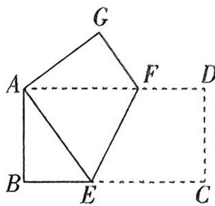

<!-- question-source:start -->
4[2025 江苏徐州调研, 中]如图, 将一张矩形纸片 ABCD 沿 EF 折叠, 使 C, A 两点重合, 点 D 落在点 G 处. 已知 AB = 4, BC = 8.

(1) 求证: $\triangle AEF$ 是等腰三角形;

建议用时 35 分钟 答案 D16

(2)求线段 $FD$ 的长.

<!-- question-source:end -->

![[Q00107357A1]]
