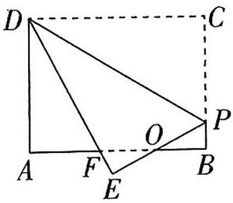
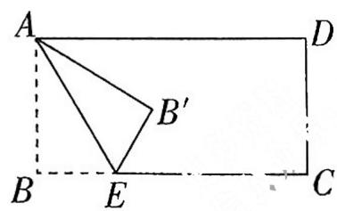

<!-- question-source:start -->
5 [2025 重庆沙坪坝区质检, 中] 如图, 矩形纸片 ABCD 中, AB = 4, BC = 3, 点 P 在 BC 边上, 将 $\triangle CDP$ 沿 DP 折叠, 点 C 落在点 E 处, PE, DE 分别交 AB 于点 O, F, 且 OP = OF, 则 BF 的长为 ( )
A. 1 B. 2 C. 3 D. 2.4

(第5题图)

(第6题图)
<!-- question-source:end -->

![[Q00107358A1]]
