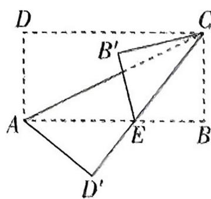

<!-- question-source:start -->
7 [2025 江苏南京调研, 较难] 如图, 矩形 $ABCD$ 的边 $AD$ 长为 2 , 将 $\triangle ADC$ 沿对角线 $AC$ 翻折得

到 $\triangle AD'C,CD'$ 与 $AB$ 交于点 $E$ ,再将 $\triangle BCE$ 沿 $CE$ 翻折得到 $\triangle B'CE$ .若两次折叠后,点 $B'$ 恰好落在 $\triangle ADC$ 的边上,则 $AB$ 的长为\_\_\_\_.

电子错题本鸭
<!-- question-source:end -->

![[Q00107360A1]]
